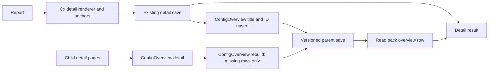

# Configuration page export architecture

This document covers the Jira `projectConfig` and Confluence `spaceConfig` page-export paths. Other endpoints have separate responsibilities described by their administrator guides.

Each endpoint remains a standalone ScriptRunner file. `Cx.render` builds the existing detail tables, Expand macros, Remark carry-over and truncation notices. It also collects section identities and counts and adds an invisible Anchor macro immediately before each section's Expand macro. `ExportOutcome.sections` passes those summaries to the overview updater.

`ConfigOverview` owns the managed table's storage format, identity parsing, title/ID matching and native page/anchor links. Start/end anchors delimit the managed region; column anchors hold stable section kinds and row anchors hold page IDs. Existing content outside the region is retained verbatim. Jira and Confluence have separate product markers, so both tables may coexist on one parent. New section kinds extend the columns without discarding older rows.

`OverviewExport.maintain` runs after successful detail export. Its read/write callbacks keep platform APIs out of the pure helper classes. It reads a fresh parent body and version, upserts by linked title with ID fallback, saves, then verifies the actual row and newer version at the target. Its outcome is independent of the detail export: `skipped`, `updated`, `failed` or `unknown`.

`OverviewExport.rebuild` restores missing rows without a detail export. The endpoint's `rebuild-overview` action lists the direct children of the selected overview page (Confluence: `Page.getChildren()` filtered by `isCurrent()`; Jira: `confluenceChildPages` over the application link, paged by `_links.next`), reads each body on its own and parses it with `ConfigOverview.detail`. That parse is the inverse of the detail renderer: the header name is the row label, and each section anchor followed by its Expand title gives the section key, label and count. Anything that does not parse exactly refuses the page. `ConfigOverview.rebuild` adds a row only for a page ID the table does not hold and skips a page whose title belongs to a row with another ID, so existing rows are never rewritten. All additions go into one versioned save; each added row is then confirmed with `confirmed()`. Its outcome is `updated`, `unchanged` (nothing missing, no write), `failed` or `unknown`. A child that could not be read is `unread` and the response is `complete: false`. On Confluence the rebuild runs in its own `PageExportTransaction` and reuses the export's overview read and save closures.

The minimal report (`report=minimal` on GET, the `minimal` action on the existing POST route) writes no detail page. `MinimalReport`, embedded identically next to `ConfigOverview`, owns one managed table on the selected overview page with its own `cfcon-minimal-<product>-` anchors: start and end markers, a column anchor on each generated heading and a row anchor holding the project or space key in each key cell. Its merge rewrites the generated cells of the exported rows and keeps every other column and row verbatim, so administrators maintain their topic columns in the table itself; a new table starts with Themengebiet 1 and 2. Rows of keys that no longer exist are marked, given a complete key list. `MinimalReport.update` runs the stages of `OverviewExport.maintain` (fresh read, merge, one versioned save, read-back confirmation) for all selected keys at once. `ConfigOverview`, `OverviewExport`, the detail export and its route are unchanged. Jira reads the values through the Project, ProjectRoleManager, IssueManager and SearchService APIs and the app columns through the screen and workflow schemes with the footprint's attribution rules; Confluence reads stored facts with set-based statements and the macro usage through the content index, both outside the export transaction, and creates the overview page and saves the table inside it. The minimal export writes no export log entry.

Jira retains its administrator gate and authenticated application-link factory. `confluenceOverviewRead` expands body storage, version and space through `confluenceCall`; `confluenceOverviewWrite` sends a versioned body update without changing ancestors. Confluence retains its administrator gate and existing PageService/PageManager APIs, cloning the original parent before saving with notifications suppressed. No new credentials, scopes or alternate transport are introduced.

Confluence's `PageExportTransaction` runs the persistence reads, typed-parent creation, detail save/move and overview update in one SAL unit of work. This follows [Atlassian's transaction guidance](https://developer.atlassian.com/server/confluence/hibernate-sessions-and-transaction-management-guidelines/): related manager mutations must share a transaction to avoid inconsistent Hibernate objects between calls. SAL uses `PROPAGATION_REQUIRED`, joining an existing transaction when present. Its types are resolved at runtime like the existing database adapter. The prepared HTTP response is returned only after `execute` completes. Error responses abort the unit of work; commit exceptions produce a transaction error rather than a successful detail/overview result. Pure overview parsing or verification can still report an independent problem when the transaction completes successfully; an ORM error that marks the transaction for rollback cannot retain a partial-success claim.

The overview adds names, section counts and links, not configuration property values. Detail property-value guards and Remark parsing remain in their existing locations. Page restrictions and transport permissions remain platform responsibilities; live behavior is verified on the target instance rather than inferred from offline tests.

The embedded pure helper classes are byte-identical in both endpoint files. `tools/tests/export-overview.tests.groovy` runs against each endpoint's actual extracted classes and checks their parity. `python3 tools/run-config-tests.py` runs the two source-based suites, endpoint parse checks and `tools/config-overview-typecheck.groovy`. The latter statically checks `ConfigOverview` and `OverviewExport` against their actual platform-free dependencies, loaded dynamically, and fails on diagnostics. CI runs the same static gate for both configuration endpoints. The Confluence transaction suite executes the actual export branch and statically checks its transaction adapter against documented API contract stubs. Its synthetic persistence lifecycle covers first-run overview creation, repeat exports, rollback and guards; it does not prove the particular Hibernate mechanism or live instance behavior. These checks do not replace instance-classpath checking of platform-dependent code. `python3 tools/shared-renderer-drift.py` checks existing shared renderer contracts.
